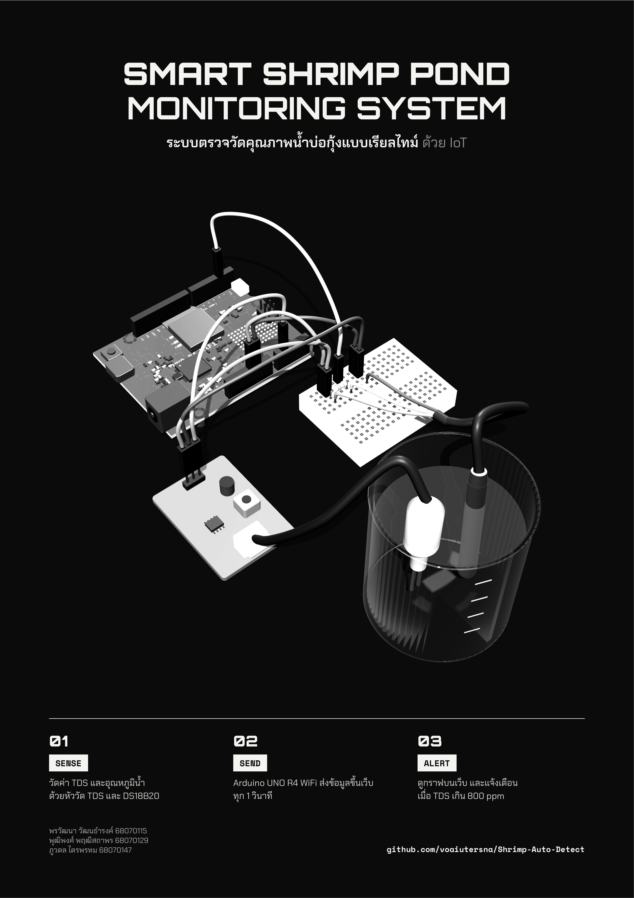

# Smart Shrimp Pond Monitoring System 🦐
ระบบตรวจวัดคุณภาพน้ำบ่อกุ้งแบบเรียลไทม์ด้วย IoT

<!-- TODO: ใส่ชื่อรายวิชา รหัสวิชา ภาคเรียน และปีการศึกษา -->
> โปรเจกต์นี้จัดทำขึ้นในรายวิชา **PHYSICAL COMPUTING 06016409** ภาคเรียนที่  1  ปีการศึกษา  2569 
> คณะเทคโนโลยีสารสนเทศ สถาบันเทคโนโลยีพระจอมเกล้าเจ้าคุณทหารลาดกระบัง

## ที่มาของโปรเจกต์
กุ้งไวต่อการเปลี่ยนแปลงของน้ำมาก ถ้าปริมาณของแข็งที่ละลายในน้ำ (TDS) สูงเกินไป หรืออุณหภูมิน้ำแกว่ง กุ้งจะเครียด กินอาหารน้อยลง และอาจตายยกบ่อได้ ปัญหาคือเกษตรกรส่วนใหญ่ยังต้องตักน้ำไปวัดเองเป็นครั้งคราว ทำให้รู้ตัวช้า

Shrimp Auto Detect จึงวัดค่า TDS และอุณหภูมิน้ำอย่างต่อเนื่องด้วยบอร์ด Arduino UNO R4 WiFi ส่งข้อมูลขึ้นเว็บทุก 1 วินาที และแจ้งเตือนบนหน้าเว็บทันทีเมื่อน้ำไม่เหมาะกับการเลี้ยงกุ้ง

## ความสามารถของระบบ
- วัดค่า **TDS (ppm)** และ **อุณหภูมิน้ำ (°C)** แบบต่อเนื่อง
- กรองสัญญาณรบกวนด้วย median filter 30 ค่า และชดเชยค่า TDS ตามอุณหภูมิน้ำ
- ส่งข้อมูลผ่าน Wi-Fi ไปยังเซิร์ฟเวอร์ทุก 1 วินาที (ป้องกันด้วย API key)
- แดชบอร์ดเว็บแสดงค่าล่าสุด กราฟย้อนหลัง และสถิติ 24 ชั่วโมง (เฉลี่ย / ต่ำสุด / สูงสุด)
- **แจ้งเตือนทันทีเมื่อ TDS เกิน 800 ppm** ว่าน้ำไม่เหมาะสำหรับกุ้ง
- แสดงสถานะว่าบอร์ดยังออนไลน์อยู่หรือไม่
- ดาวน์โหลดข้อมูลทั้งหมดเป็นไฟล์ CSV

### เกณฑ์ระดับ TDS ที่ใช้บนแดชบอร์ด
| ค่า TDS (ppm) | ระดับ |
|--|--|
| ต่ำกว่า 50 | ต่ำมาก (ใกล้เคียงน้ำกลั่น/RO) |
| 50 – 299 | ดีมาก |
| 300 – 799 | พอใช้ |
| 800 ขึ้นไป | สูง ⚠️ แจ้งเตือน |

## ภาพรวมการทำงาน
```
TDS Sensor ─┐
            ├─► Arduino UNO R4 WiFi ──(Wi-Fi, HTTP POST ทุก 1 วิ)──► Node.js + Express ──► SQLite
DS18B20 ────┘                                                              │
                                                                           ▼
                                                              เว็บแดชบอร์ด (กราฟ + แจ้งเตือน)
```

## อุปกรณ์
- Arduino UNO R4 WiFi
- TDS Meter (โมดูลอนาล็อก + หัววัด)
- DS18B20 แบบกันน้ำ (เซนเซอร์อุณหภูมิ)
- ตัวต้านทาน 4.7 kΩ
- เบรดบอร์ดและสายจัมเปอร์

### การต่อวงจร
| อุปกรณ์ | ขาอุปกรณ์ | ต่อเข้า Arduino |
|--|--|--|
| TDS Sensor | VCC | 5V |
| | GND | GND |
| | Signal (A) | A1 |
| DS18B20 | VCC | 5V |
| | GND | GND |
| | DATA | D2 (ต่อตัวต้านทาน 4.7 kΩ คร่อมระหว่าง DATA กับ 5V) |

## โครงสร้างโปรเจกต์
```
Shrimp-Auto-Detect/
├── arduino/
│   └── arduino.ino      # อ่านเซนเซอร์และส่งข้อมูลขึ้นเซิร์ฟเวอร์
└── server/
    ├── server.js        # API + ฐานข้อมูล SQLite
    ├── .env.example     # ตัวอย่างการตั้งค่า
    └── public/
        ├── index.html   # แดชบอร์ด
        └── about.html   # หน้าเกี่ยวกับโครงงาน
```

## วิธีติดตั้งและใช้งาน

### 1. เซิร์ฟเวอร์
ต้องใช้ Node.js เวอร์ชัน 20.12 ขึ้นไป
```bash
cd server
npm install
cp .env.example .env   # แล้วแก้ API_KEY เป็นค่าของตัวเอง
npm start
```
เปิดแดชบอร์ดที่ `http://localhost:3000`

### 2. บอร์ด Arduino
1. ติดตั้งไลบรารี **OneWire** และ **DallasTemperature** ใน Arduino IDE
2. เปิด `arduino/arduino.ino` แล้วแก้ค่าเหล่านี้ให้ตรงกับเครื่องของคุณ
   - `WIFI_SSID` และ `WIFI_PASSWORD`: ชื่อและรหัส Wi-Fi
   - `SERVER_HOST`: IP ของเครื่องที่รันเซิร์ฟเวอร์ (ดูได้จาก `ipconfig` หรือ `ifconfig`) ต้องอยู่ใน Wi-Fi วงเดียวกับบอร์ด
   - `API_KEY`: ต้องตรงกับ `API_KEY` ในไฟล์ `.env`
3. อัปโหลดโค้ดลงบอร์ด แล้วเปิด Serial Monitor (9600 baud) เพื่อดูค่าที่อ่านได้

## API
| Method | Path | ใช้ทำอะไร |
|--|--|--|
| `POST` | `/api/readings` | บอร์ดส่งค่า `{ "temperature": 28.5, "tds": 412.0 }` (ต้องมี header `x-api-key`) |
| `GET` | `/api/readings?limit=200` | ดึงค่าล่าสุดตามจำนวนที่กำหนด (สูงสุด 20,000) |
| `GET` | `/api/readings?from=<ms>&to=<ms>` | ดึงค่าตามช่วงเวลา |
| `GET` | `/api/stats?hours=24` | สถิติย้อนหลังตามจำนวนชั่วโมง |
| `GET` | `/api/export.csv` | ดาวน์โหลดข้อมูลทั้งหมดเป็น CSV |

## เทคโนโลยีที่ใช้
Arduino (C++) · Node.js · Express · SQLite (better-sqlite3) · Chart.js · Tailwind CSS

<!-- TODO: ใส่ลิงก์เมื่อพร้อม -->
## เว็บไซต์โปรเจกต์
https://shrimp-auto-detect-doc.vercel.app/

## วิดีโอสาธิต
[ลิงก์ YouTube]

## โปสเตอร์


## สมาชิก
<!-- TODO: ใส่หน้าที่ของแต่ละคน -->
| รหัสนักศึกษา | ชื่อ | หน้าที่ |
|--|--|--|
| 68070115 | นายพรวัฒนา วัฒนธำรงค์ | Website & Poster |
| 68070129 | นายพุฒิพงศ์ พฤฒิสถาพร | Github Document & VDO editor |
| 68070147 | นายภูวดล ไตรพรหม | Arduino Circuit Designer & .ino |
